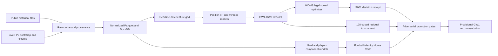

# FPLAgent 2026/27 GW1 picker: technical report and improvement programme

**Report date:** 2 August 2026  
**Current FPL deadline represented:** Gameweek 1, 21 August 2026 at 17:30 UTC  
**Current status:** a strong, reproducible **provisional** GW1 recommendation; it must be refreshed before the deadline  
**Current recommendation:** candidate **S001**

## Executive conclusion

FPLAgent has progressed beyond a player-ranking script. It is now a reproducible decision pipeline
that:

1. collects public historical and current FPL data with source provenance;
2. reconstructs deadline-safe historical features instead of training on obvious post-match data;
3. trains position-specific expected-points and participation models on the RTX 5090;
4. converts forecasts into a legal, transfer-aware 15-player squad with an exact mixed-integer
   optimiser;
5. attacks that squad with forecast perturbations, premium-return scenarios, appearance
   recalibration, 128 alternative constructions and two different Monte Carlo engines; and
6. records the answer, model, forecast, rules and source hashes in a decision receipt.

The current recommended squad is:

| Role | Players |
|---|---|
| Goalkeeper | Donnarumma |
| Defenders | Virgil, Tarkowski, Senesi, Truffert, Mukiele |
| Midfielders | Bruno Fernandes, Mbeumo |
| Forwards | João Pedro, Igor Thiago, Calvert-Lewin |
| Bench order | Xhaka, Szoboszlai, Mateus Fernandes, Verbruggen |
| Captain / vice | Bruno Fernandes / Senesi |

It costs **£99.5m**, leaves **£0.5m** in the bank, projects at **58.20 points in GW1**, and starts in
a **5-2-3**.

The central conclusion is not that this exact squad is certain to be correct. The evidence supports
the following narrower and more defensible claim:

> Given the public data available in the 2 August snapshot, the implemented forecast, the live
> 2026/27 rules and the tested five-week planning assumptions, no generated alternative has shown a
> repeatable, historically supported advantage over S001 once both squads receive the same transfer
> opportunities.

That is a solid foundation for a GW1 picker. It is not yet proof of a full-season winning agent, and
it is not permission to ignore the next nineteen days of transfers, injuries, friendlies and team
news.

## What “solid” means here

The picker earns that description through several independent properties:

- **Point-in-time discipline:** 244,425 historical player/gameweek records pass hard lag and
  snapshot-timing checks. Historical same-gameweek `xP` is explicitly banned.
- **Out-of-season testing:** forecasts are evaluated by training only on seasons earlier than the
  test season, separately for all four positions.
- **Decision metrics:** promotion depends on shortlist returns and legal squad replay, not MAE alone.
- **Exact legality:** budget, positions, formation, club limits, captaincy and transfer carry are
  solver constraints, then validated again independently.
- **Alternative search:** the incumbent was challenged by 128 legal squads spanning 205 players,
  premium combinations, four bench-price bands, three horizon decays and forecast perturbations.
- **Two outcome models:** a historical residual simulator and a football-component simulator both
  retain S001 as the best transfer-aware route.
- **Adversarial gates:** the component challenger cannot overrule the incumbent merely because its
  raw simulation produces a dramatic result. Its influence was chosen on one historical season and
  tested unchanged on the next.
- **Reproducibility:** source, rule, model, forecast, candidate and result artifacts are hashed.

It does **not** mean:

- that S001 will outscore every alternative in the realised five matches;
- that the Monte Carlo confidence interval captures unknown injuries or all model error;
- that the current future transfers should be executed without replanning;
- that the defensive-heavy construction is proven across several comparable rule seasons; or
- that a prospective 2026/27 track record already exists.

## System architecture



The design deliberately separates four questions:

1. **What did we know before a deadline?** — the data and feature layer.
2. **What is each player worth?** — the forecast layer.
3. **What legal action maximises the chosen horizon?** — the optimiser.
4. **How fragile is that action?** — perturbations, backtests and scenario simulation.

This separation is important. A solver cannot repair bad forecasts, and a good average forecast can
still produce a poor squad if captaincy, substitutions or transfer state are modelled incorrectly.

## 1. Data sources

Only publicly retrievable files and no-login endpoints were used. Public availability is not the
same as a commercial redistribution licence; that distinction remains an explicit product risk.

### 1.1 Current official FPL data

The live 2026/27 snapshot came directly from the FPL application's public endpoints:

- [`bootstrap-static`](https://fantasy.premierleague.com/api/bootstrap-static/): players, teams,
  events, positions, chips, rules and prices;
- [`fixtures`](https://fantasy.premierleague.com/api/fixtures/): the current fixture schedule and
  difficulty fields.

The final cached bootstrap used here was fetched at **2026-08-02 10:02:54 UTC**, contains 564 raw
players, 20 teams and 38 events, and has SHA-256
`41eb63c76cb6d4b863e2ff470ebcc65fd71b643110a81fcb16d49e13e348a50f`.

An important preseason caveat is that bootstrap mixes current player IDs, clubs, prices and rules
with statistical totals carried over from 2025/26. Those totals are not treated as observed
2026/27 outcomes. The live feature grid keeps 559 currently selectable players over eight future
events, producing 4,472 player/horizon rows.

### 1.2 Historical match and player data

The main historical corpus is [Vaastav's Fantasy Premier League repository](https://github.com/vaastav/Fantasy-Premier-League):

- player/gameweek and player snapshot coverage from 2016/17 through 2025/26;
- 253,890 normalized player/fixture rows;
- fixture coverage from 2018/19 through 2025/26;
- team tables from 2019/20 through 2025/26.

FPL's `element` identifier changes between seasons. Player history is joined through the more stable
FPL player `code`, while each season's position remains explicit. The pipeline checks for null
identities and duplicate player/event keys.

Vaastav's [data dictionary](https://github.com/vaastav/Fantasy-Premier-League/blob/master/DATA_DICTIONARY.md)
warns that historical `xP`/`ep_this` may have been captured after matches. That field is retained
only as an unsafe diagnostic and is forbidden from production features.

### 1.3 Deadline-proxy reconstruction

Final season files know things a manager did not know at the deadline: final prices, final injury
status and later fixture rescheduling. The pipeline therefore queries Vaastav's public Git commit
history to recover the latest observable player, fixture and team files before inferred deadlines.

Coverage is incomplete but useful:

| Season | Deadline-proxy events |
|---|---:|
| 2023/24 | 37 |
| 2024/25 | 35 |
| 2025/26 | 11 |

There are 61,870 player observations with a proxy snapshot, and every one used by the training
contract precedes its inferred deadline. Missing proxies stay explicit through the
`deadline_proxy_available` feature rather than being presented as exact history.

### 1.4 Historical manager evidence

Manager datasets were used to study behaviour and set hypotheses, not as labels that say “copy
this winner”:

| Source | Coverage | Use |
|---|---|---|
| [Solio EOS](https://eos.solioanalytics.com/) | 2025/26 population outcome index | Separate projected decision quality from realised variance |
| [FPL Genius](https://fplgeni.us/) public application endpoint | 2025/26 top 100, 3,800 captain decisions and transfer trails | Descriptive captain/transfer behaviour; third-party model scores kept separate |
| Mike Croft public Reddit posts and Google workbooks | April 2016–May 2026; 176 available workbooks | Veteran-manager histories and hypotheses |
| Vaastav/Paul top-manager archives | 2019/20 top 10/top 50 | Lineup, captain, transfer, bench and budget diagnostics |
| Titan public cohort | 27 managers in 2022/23 | Small independent behaviour cross-check |
| Soong public archive | seven managers in 2025/26 | Supporting final-state and chip histories |

Top-manager datasets are selected after their success is known. They cannot prove that a
differential captain, expensive bench or number of hits caused the rank. The engine therefore uses
them descriptively and requires the forecast/simulation to establish any prospective benefit.

### 1.5 Provenance and storage

Raw downloads, normalized Parquet tables, model artifacts, forecasts and decisions live in separate
directories. Every HTTP fetch records its URL, time, byte count, status and SHA-256 in
`data/manifests/raw_files.jsonl`. Generated research tables are queryable through
`data/fpl_history.duckdb`.

One implementation detail needs improvement: forced refreshes of the current official API append a
new manifest entry but currently overwrite the same preseason cache filename. The latest response
is reproducible, but earlier differing live payloads are not retained under unique timestamped
paths. The live collector should become append-only before the first deadline.

## 2. Lessons extracted from history

The historical analysis changed the design in several ways.

### 2.1 Process matters, but first place still needs variance

The 2025/26 top 100 averaged **2,504.1 points**, compared with **2,090.9** for the 3.53 million
active-manager population. Solio attributed 234.6 of that 413.2-point gap to projected quality of
weekly picks and 178.7 points to finishing above projection.

Only two actual top-100 managers were themselves projected top 100. Conversely, the best 100 by
projection had a median actual rank of 7,448; 55% finished inside the top 10k and 16% inside the top
1k. The product conclusion is that strong expected decisions materially improve the finishing
distribution, while the single realised winner will also receive favourable variance.

### 2.2 Transfers should be evaluated over several weeks

The top-100 cohort's player-in minus player-out return grew from 2.1 points at one week to 3.0 over
three and 4.5 over five. They rolled a transfer in 11.1 weeks on average. This motivated:

- multiple forecast horizons;
- free-transfer carry as explicit state;
- “roll” as a valid action; and
- no artificial reward for making a transfer.

### 2.3 Rarity is not an objective

Top-100 managers deviated from the FPL Genius comparator captain 1,565 times and those realised
deviations performed well. Because the cohort was selected on final rank, using this as a
“differential bonus” would be survivor bias. FPLAgent maximises points by default and does not
reward low ownership. Ownership is a market prior feature, not a direct source of utility.

### 2.4 Bank and bench require opportunity-cost tests

The earlier apps' habit of leaving money unused was suspicious, but “spend everything” is not a
valid rule. Bank can avoid a later hit or unlock a planned transfer. Likewise, minimizing historical
bench points is not the same as selecting the best preseason squad.

The implemented response is to:

- include budget in an exact multi-week optimisation;
- compare the best alternative squad directly;
- generate candidates in four bench-cost bands; and
- simulate formation-valid autosubs instead of assuming bench value is always wasted.

## 3. Point-in-time feature engineering

The main training table has **244,425 player/gameweek rows** and 54 columns. The model consumes 41
features. A historical double gameweek is aggregated to one player/gameweek decision target while
retaining its fixture count and average home/difficulty context.

### 3.1 Lagged player features

Every rolling window ends at the previous event:

- prior-event points and minutes;
- 3-, 5-, 10- and 38-event point averages;
- 3-, 5- and 10-event minute averages;
- five-event appearance and 60-minute start rates;
- five-event goals, assists, xG, xA, BPS, clean sheets and defensive contributions;
- history length and days since the previous event.

The SQL windows use `ROWS BETWEEN n PRECEDING AND 1 PRECEDING`; the target event is excluded by
construction. Separate executable checks recompute `last_points` and `form5_points` and found zero
mismatches.

### 3.2 Deadline-context features

Where a pre-deadline proxy exists, the row adds:

- price;
- within-deadline ownership percentile;
- official availability chance/status;
- penalty order and corner/free-kick order;
- fixture count, home fraction and fixture difficulty.

Ownership is normalized to a percentile because old files expose manager counts while newer files
expose percentages. Raw incompatible scales are never mixed.

### 3.3 Team and opponent form

Historical fixtures are expanded into one row per team side. Rolling goals for and against over the
previous five and ten matches produce team and opponent attack/defence features. Match counts, rest
days, home status and fixture difficulty provide context.

For 2026/27, the newest historical team state is matched by team code to the current fixture grid.
Coventry City and Hull City have no Premier League prior in the ten-season corpus; Ipswich Town's
prior is 454 days old. These remain null/stale signals with live FPL fixture difficulty available,
not invented league-strength estimates.

### 3.4 Cold starts and missing eras

Players without a matching historical `player_code` receive `cold_start=1`; XGBoost handles their
missing feature values natively. Forecast uncertainty adds a cold-start penalty, but there is not
yet a proper cross-league translation model.

Pre-2022/23 expected-stat fields and pre-2025/26 defensive-contribution fields remain null. Filling
them with zero would falsely say that the event was observed and did not happen.

### 3.5 Data-quality gate

All 13 hard checks passed:

| Check | Result |
|---|---:|
| Historical rows | 244,425, above 200,000 minimum |
| Duplicate historical keys | 0 |
| Null player codes | 0 |
| Incorrect `last_points` lag | 0 |
| `form5` rows containing target event | 0 |
| Snapshot observations after deadline | 0 |
| Synthetic pre-era xG values | 0 |
| Duplicate current player/horizon keys | 0 |
| Current grid | 559 players × 8 events = 4,472 |
| Missing required current fields | 0 |
| Ownership range | [0, 1] in every season |
| Forbidden target fields in allowlist | 0 |
| Selectable pool | 61 GK, 185 DEF, 247 MID, 66 FWD |

Passing this gate means the implemented contracts are internally consistent. It cannot make an
incomplete historical snapshot exact or create information that was never public.

## 4. Primary player forecast: `forecast_v2`

### 4.1 Why a hurdle model

A player's points are only available if the player appears. A single regressor trained over all
rows can obtain a deceptively low error by predicting near zero for rotation players. FPLAgent uses
two linked models for each position:

1. a four-class minutes classifier for `DNP`, `1–59`, `60–89`, and `90+` minutes;
2. a points regressor trained only on rows in which the player appeared.

For a player feature vector \(x\):

\[
\operatorname{E}[P \mid x]
= \Pr(M > 0 \mid x)\operatorname{E}[P \mid M>0,x].
\]

This is an expected-points forecast, not a prediction that the player will score the decimal value
in one match.

### 4.2 Model family and parameters

Four position-specific ensembles are trained: GK, DEF, MID and FWD. Each contains two point models
and two minutes models with seeds 17 and 43.

The points model is an XGBoost squared-error regressor:

- 250 final estimators, learning rate 0.035;
- maximum depth 5, minimum child weight 8;
- row/column subsampling 0.82;
- L1 0.15 and L2 6.0 regularisation.

The minutes model is a four-class XGBoost soft-probability classifier:

- 242 final estimators, learning rate 0.04;
- maximum depth 4, minimum child weight 8;
- row/column subsampling 0.85;
- L1 0.10 and L2 6.0 regularisation.

Both use histogram trees on `cuda:0`. Training aborts unless a real CUDA fit remains on the GPU.
The recorded environment is XGBoost 3.3.0 on an NVIDIA GeForce RTX 5090 with driver 610.43.02.
GPU capacity accelerates training and scenario work; it is not treated as evidence of predictive
quality.

### 4.3 Training and uncertainty

The model trains over all 244,425 historical rows after passing the forward tests. It gives equal
season weight (`season_decay=1.0`). The two seeds are averaged.

Production expected points use 100% model weight. Availability-adjusted five-event form remains a
frozen benchmark, not part of the final blend. The forecast also records:

- `p_dnp`, `p_1_59`, `p_60_89`, `p_90_or_more` and `p_play`;
- ensemble disagreement;
- an epistemic diagnostic that adds 0.65 for cold starts and 0.2 for histories under five events;
- `robust_points = expected_points - 0.15 × epistemic_uncertainty`.

The current optimiser maximises `expected_points`; `robust_points` is reported and used for audit,
not yet used as the primary objective. Risk is tested through perturbation and simulation instead
of an arbitrary universal mean-minus-variance penalty.

## 5. Forecast validation

### 5.1 Rolling season-forward design

The test seasons are 2023/24, 2024/25 and 2025/26. For each test season and position:

- only earlier seasons train the model;
- the most recent prior season is reserved for early stopping;
- the test season remains unseen until evaluation;
- points are evaluated on every eligible player/gameweek, not just the selected squad.

This creates 12 position-season slices and 84,999 out-of-fold forecasts.

### 5.2 Promotion gate

Against availability-adjusted five-event form, the promoted model achieved:

| Gate | Required | Achieved |
|---|---:|---:|
| Position-season slices | 12 | 12 |
| MAE wins | at least 10 | 10 |
| Rank-correlation wins | at least 6 | 6 |
| Top-shortlist wins | at least 10 | 12 |
| Mean shortlist lift | positive | +0.428 points/player/GW |
| GW1 shortlist wins | at least 7 | 8 |
| Mean GW1 shortlist lift | positive | +0.461 points/player |

The shortlist cutoffs are five goalkeepers, 15 defenders, 15 midfielders and eight forwards per
gameweek. This aligns evaluation more closely with the optimiser's decision tail than population
MAE alone.

Weighted across positions, model MAE was lower than form in every test season:

| Test season | Model MAE | Five-event form MAE | Mean top-k lift |
|---|---:|---:|---:|
| 2023/24 | 0.958 | 0.984 | +0.417 |
| 2024/25 | 0.999 | 1.032 | +0.472 |
| 2025/26 | 0.982 | 1.053 | +0.396 |

### 5.3 Legal historical GW1 replay

The out-of-fold forecasts were also passed through a legal £100m squad, XI and captain optimiser:

| Season | Model squad | Form squad | Lift |
|---|---:|---:|---:|
| 2023/24 | 35 | 35 | 0 |
| 2024/25 | 56 | 40 | +16 |
| 2025/26 | 48 | 46 | +2 |

The model gains 18 points in total with no losing season. This is encouraging but only three GW1
observations; it is a diagnostic, not a reliable estimate of expected seasonal advantage.

## 6. Exact squad and transfer optimisation

The decision problem is solved with the HiGHS mixed-integer solver. Binary variables represent
membership, starting status, captaincy and transfers for each player and event. Integer state tracks
the free-transfer bank.

### 6.1 Hard constraints

The solver enforces the live API rules:

- £100.0m budget;
- 15 players in a 2/5/5/3 position split;
- 11 starters with legal 1 GK, 3–5 DEF, 2–5 MID and 1–3 FWD formation;
- no more than three players from a club;
- exactly one starting captain;
- transfers in equal changes to successive squads;
- one initial free transfer and carry up to five.

The resulting squad and every future lineup are then passed through separate validation functions.
Solver feasibility is therefore not the only legality check.

### 6.2 Objective

For event \(g\), the weight is \(0.88^{g-1}\). Over GW1–GW8 the objective is:

\[
\sum_g 0.88^{g-1}
\left(
\sum_i xP_{ig}\,start_{ig}
+ \sum_i xP_{ig}\,captain_{ig}
+ 0.08\sum_i xP_{ig}(squad_{ig}-start_{ig})
\right).
\]

Adding the captain term produces the double score. The 0.08 bench term is a small autosub proxy in
the deterministic optimiser; exact autosubs are tested later in simulation. A `10^-6` transfer
penalty breaks otherwise equivalent routes in favour of less activity, but does not materially
change point trade-offs.

Future values decay because distant forecasts and fixture schedules are less certain. The initial
squad remained identical when the decay was changed to 0.80 and 0.95.

Hits, future prices and chips are not in this initial optimiser. It can plan free transfers only.

## 7. The current decision receipt

### 7.1 Squad and GW1 roles

| Pos | Player | Club | Price | GW1 xP | Play probability | Role |
|---|---|---|---:|---:|---:|---|
| GK | Donnarumma | MCI | £5.5m | 4.51 | 89% | Start |
| GK | Verbruggen | BHA | £4.5m | 3.57 | 90% | Bench 4 |
| DEF | Virgil | LIV | £6.5m | 4.76 | 91% | Start |
| DEF | Tarkowski | EVE | £6.0m | 5.03 | 90% | Start |
| DEF | Senesi | TOT | £6.0m | 5.16 | 92% | Start, vice-captain |
| DEF | Truffert | BOU | £5.5m | 4.79 | 91% | Start |
| DEF | Mukiele | SUN | £5.5m | 4.98 | 88% | Start |
| MID | Bruno Fernandes | MUN | £12.0m | 5.59 | 93% | Start, captain |
| MID | Mbeumo | MUN | £8.0m | 4.74 | 88% | Start |
| MID | Szoboszlai | LIV | £7.0m | 3.63 | 93% | Bench 2 |
| MID | Mateus Fernandes | TOT | £6.0m | 3.62 | 94% | Bench 3 |
| MID | Xhaka | SUN | £5.5m | 4.09 | 94% | Bench 1 |
| FWD | Igor Thiago | BRE | £8.0m | 4.45 | 92% | Start |
| FWD | João Pedro | CHE | £7.5m | 4.46 | 83% | Start |
| FWD | Calvert-Lewin | LEE | £6.0m | 4.13 | 89% | Start |

The decision receipt's eight-week objective is 317.219. The best squad constrained to differ from
S001 scores 317.194 and changes only Verbruggen to Leno, a gap of **0.026 objective points**. This
thin deterministic gap is why peripheral names should not be presented with false certainty.

Across 20 player-level model-error perturbations:

- only 25% reproduce the exact same 15;
- the mean S001 player is retained 92% of the time;
- Bruno remains captain 85% of the time;
- eleven players appear in at least 90% of solutions.

The stable object is therefore the squad's **core and structure**, not every last bench slot.

### 7.2 Provisional transfers

The eight-week receipt currently suggests:

- GW2: Mukiele → Hill;
- GW3: Mbeumo → Semenyo;
- GW4: Igor Thiago → Watkins;
- GW5: roll;
- later moves involving Mukiele, Pedro Porro, Botman and Gibbs-White.

The separate five-week finalist optimisation instead uses Truffert → Justin in GW5. That
disagreement is useful evidence: future paths respond to horizon and terminal value. The initial 15
is the present recommendation; future transfers are placeholders that must be re-solved with new
information.

## 8. Residual Monte Carlo tournament

The first scenario engine asks whether S001 survives realistic-looking forecast errors without
requiring a complete football event model.

### 8.1 Candidate generation

The system generated 128 unique legal squads:

- the incumbent and deterministic static-xP alternative;
- forced inclusion and GW1 starts for every £9m+ MID/FWD premium and combinations of the leading
  premiums;
- four GW1 bench bands: at most £18.5m, £18.6–20.0m, £20.1–22.0m and above £22.0m;
- player and player/event forecast perturbations at scales 0.12, 0.20, 0.32, 0.48 and 0.70;
- future-point decay at 0.80, 0.88 and 0.95.

The field spans 205 players. Two squads share 9.47 of 15 players on average, with a range of 4–14.

### 8.2 Residual calibration

The simulator uses 84,999 rolling out-of-fold forecasts, including 32,667 played rows and 1,140
historical fixtures. Played-player error is decomposed into:

- a position-specific gameweek shock;
- a shrunk team/fixture shock; and
- an idiosyncratic residual drawn from position and forecast-strength quintiles.

A Gaussian copula carries player appearance risk across adjacent events. A separate latent term
carries persistent player performance error. Estimated adjacent-event correlations are modest:
`play_rho=0.0586` and `points_rho=0.0162`.

Residual scales were selected on 2024/25 interval coverage and frozen for 2025/26: GK 0.65, DEF
0.40, MID 0.40 and FWD 0.45.

The season-forward marginal replay covers 36,442 player/gameweeks. Its nominal P10–P90 interval
contains 79.75% of realised values, close to the intended 80%, with -0.050 mean-point bias.

Every scenario applies exact formation-valid substitutions and captain-to-vice fallback.

### 8.3 Discovery and holdout

The tournament uses 5,000 paths for discovery and a separate 25,000-path holdout. Candidate rank
correlation between the two is effectively 1.000, indicating Monte Carlo sample noise is not
driving the order.

In the fixed-squad holdout, S002 leads S001 by only 0.28 points over GW1–GW5. When finalists receive
the same legal free-transfer planning envelope:

| Candidate | Five-week mean | Difference from S001 |
|---|---:|---:|
| S001 | 313.26 | — |
| S002 | 310.44 | -2.83 |
| S030 | 309.98 | -3.29 |
| Best Saka policy | 308.60 | -4.66 |
| Best Palmer policy | 307.69 | -5.57 |
| Best Haaland policy | 304.41 | -8.86 |
| Best Isak policy | 301.98 | -11.29 |

This is why S001 is selected on policy value rather than its fixed-squad mean.

### 8.4 Appearance and premium stresses

The high-probability participation forecasts are conservative historically. A position-specific
isotonic reliability map raises live play probability by 0.033 on average while preserving every
player's mean xP. S001 remains the policy recommendation.

A generic premium-return scenario raises the participation of available, highly owned £9m+
midfielders/forwards after a 60+ day break. It raises Haaland's GW1 forecast from 3.41 to 4.67,
Saka's from 3.50 to 3.88 and Isak's from 1.74 to 2.81. The selected 15 and Bruno captaincy remain
unchanged. Haaland's £15.5m opportunity cost, not only a fragile DNP estimate, drives his exclusion.

## 9. Football-component challenger

The residual simulator preserves historical covariance but cannot guarantee football identities.
A second engine independently reconstructs points from goals, minutes and other match events.

### 9.1 Team-goal model

A CUDA XGBoost Poisson regressor predicts goals for each fixture side from:

- home/away status and FPL fixture difficulty;
- team and opponent five- and ten-match attack/defence;
- logged team/opponent history counts; and
- team/opponent rest days.

It uses 350 trees, learning rate 0.025, depth 3, minimum child weight 15 and L2 8.0. The 5,643
training rows cover 2018/19–2025/26.

It beats a home/away mean-goals baseline on Poisson deviance in both forward tests:

| Test season | Model deviance | Baseline deviance | Model clean-sheet Brier | Baseline Brier |
|---|---:|---:|---:|---:|
| 2024/25 | 1.155 | 1.188 | 0.178 | 0.183 |
| 2025/26 | 1.099 | 1.126 | 0.187 | 0.190 |

The edge is real but modest. Home and away scores are generated through correlated Poisson
quantiles with a historical residual correlation of -0.0167.

### 9.2 Player event models

Additional CUDA Poisson models predict goals, assists, bonus and saves from the 41 primary features
plus four position indicators. Each uses 450 trees, learning rate 0.035, depth 4, minimum child
weight 20 and L2 8.0.

A component is promoted only if it beats its lagged baseline on Poisson deviance and does not lose
more than 0.01 event-level Spearman correlation in both 2024/25 and 2025/26.

- goals: promoted;
- assists: promoted;
- bonus: promoted;
- saves: rejected.

The save model improved deviance but lost too much ranking correlation to the strong historical
goalkeeper-save baseline, so the simulator retains the empirical fallback. This is an example of a
model being built but not allowed into the decision engine.

### 9.3 Match simulation

For every path and fixture, the simulator:

1. samples player minute classes from the forecast probabilities, then actual minutes and on-pitch
   intervals from historical position/class pools;
2. samples correlated home and away scores;
3. gives each goal a uniform match time;
4. allocates it to an on-pitch scorer using the promoted goal propensities;
5. allocates at most one on-pitch teammate assist with a historically calibrated assisted-goal
   probability;
6. charges each on-pitch defender/goalkeeper with goals conceded at the goal time;
7. derives appearance and clean-sheet points from actual simulated minutes;
8. samples saves, cards, own goals and penalties from recent position/minute rates;
9. samples defensive-contribution awards from 2025/26 position/minute-class frequencies; and
10. assigns exactly 3/2/1 bonus using a BPS-inspired event score plus the promoted bonus prior.

The current scoring table is executable code, not a prose assumption. It covers appearance, goals,
assists, clean sheets, concessions, saves, penalties, cards, own goals, bonus and defensive
contribution.

The simulation reconciles all 3,319,250 sampled team goals: 3,319,118 are allocated to players and
132 remain own/unattributed. No path has more assists than goals. Bonus averages exactly six points
per match scenario.

### 9.4 Scoring and allocation tests

- The current component formula exactly reconstructs 86,749 of 86,755 recent historical
  player-fixtures: **99.9931%**.
- Player goal and assist allocation beats a position-and-minutes baseline in both 2024/25 and
  2025/26 while holding realised team totals and player minutes fixed.
- Raw simulated league points are 89.15 per match and xP implies 91.96, versus 90.48 actual in
  2025/26; both sit within the ±10% conservation gate.
- The direct xP forecast's pooled optimizer-tail bias is at most 0.360 points by position, below the
  0.5 gate.

### 9.5 Why raw components receive only 5% decision weight

The component engine is not automatically trusted because it is more detailed. A complete
season-forward reconstruction independently fits minutes, team goals and player event components
before each test season, normalizes goals/assists to team totals, and compares reconstructed points
with the incumbent xP.

| Season | Forecast | MAE | Event Spearman | Top-k realised points |
|---|---|---:|---:|---:|
| 2024/25 | Raw component | 1.027 | 0.716 | 3.918 |
| 2024/25 | Incumbent xP | 0.989 | 0.706 | 3.969 |
| 2025/26 | Raw component | 0.983 | 0.724 | 4.030 |
| 2025/26 | Incumbent xP | 0.977 | 0.721 | 3.954 |

Weights from 0% to 100% raw component were compared on 2024/25 only. The winner was **5% raw / 95%
incumbent xP**, producing 3.985 top-k realised points. That weight was frozen before looking at the
2025/26 decision, where it scored 3.981 versus 3.954 for xP.

This rule prevented the impressive-looking 100% raw result in 2025/26 from being selected after the
fact; 100% raw had performed worse on the validation season.

In current simulation, the raw component means differ from xP by 0.235 points per candidate
player/event on average. Full anchoring would add 44.50 points to S001 over five weeks, which is too
large to hide. At the historically selected 5% raw weight, the effective component shift is only
0.45 points per gameweek. Raw, anchored and decision-weighted results are all reported.

### 9.6 Independent component-native candidates

After a 5,000-path selection run with seed 20260802, the system solved new static and transfer-aware
squads using raw weights 0%, 5%, 10%, 25%, 50%, 75% and 100% with horizon decays 0.80, 0.88 and
0.95. Deduplication produced 15 new legal challengers. They were evaluated on a separate 25,000-path
seed, 20260804.

The closest native challenger is C002:

| Candidate | Decision mean | Delta to S001 | Monte Carlo 95% CI for delta |
|---|---:|---:|---:|
| S001 | 311.00 | — | — |
| C002 | 310.80 | -0.20 | -0.32 to -0.07 |
| C004 | 309.72 | -1.28 | -1.48 to -1.09 |
| S002 | 308.46 | -2.54 | -2.78 to -2.31 |

The literal raw-component leader is C014, but its historically supported decision score is 22.67
points below S001. The component promotion gate therefore passes while leaving S001 as the answer.

The displayed confidence intervals measure Monte Carlo sampling error for paired scenario
differences. They do not include every source of epistemic error, stale news or alternative model
architecture.

## 10. Premiums, formation and bench

### 10.1 Why the other premiums are absent

Current GW1 forecasts are:

| Player | Price | xP | Play probability |
|---|---:|---:|---:|
| Haaland | £15.5m | 3.41 | 64% |
| Bruno Fernandes | £12.0m | 5.59 | 93% |
| Saka | £9.5m | 3.50 | 68% |
| Palmer | £9.5m | 3.97 | 94% |
| Isak | £9.0m | 1.74 | 54% |

Forced-premium candidates, premium pairs and generic availability recovery were all generated.
Under the historically selected component blend, the strongest transfer-aware policies still trail
S001 over five weeks: Saka -4.33, Palmer -5.03, Haaland -8.89 and Isak -10.85.

This is a forecast/value conclusion, not a permanent judgement on the players. In particular,
preseason starting-role evidence can materially change their probabilities and must trigger a new
run.

### 10.2 Why five defenders start

The 5-2-3 is unusual, but it is not a hard-coded tactical preference. Five defenders occupy the
forecast-best legal XI because:

- their current prices and projected minutes are favourable;
- clean sheets, goal threat and the retained two-point defensive-contribution award are represented;
- the component engine independently simulates clean sheets, concessions and defensive
  contributions; and
- leaner defensive and premium-heavy candidates were present in the field.

Only 2025/26 supplies directly comparable defensive-contribution evidence. The construction is an
evidence-led preseason hypothesis, not a proven permanent formation strategy.

### 10.3 Why £23m is on the bench

S001's total bench price is £23.0m, including £18.5m outfield. The 2019/20 eventual top ten averaged
£18.45m total in GW1, with a £16.5m–£24.0m range. That historical sample contains only ten
survivorship-selected managers under older pricing and rules.

The tournament gives every bench band substantial representation:

| GW1 bench band | Fixed candidates | Best fixed decision mean | Best transfer-aware finalist |
|---|---:|---:|---:|
| ≤£18.5m | 35 | S039: 302.02 | S039: 306.19 |
| £18.6–20.0m | 35 | S055: 304.85 | S055: 307.62 |
| £20.1–22.0m | 35 | S002: 306.18 | S002: 308.46 |
| >£22.0m | 23 | S030: 305.57 | S001: 311.00 |

The conclusion is not that expensive benches are inherently optimal. S002's £21m bench has the
best fixed mean; S001 wins only when its transfer route and resilience are included. Bench spend is
an audit dimension, never a rewarded feature.

## 11. Why the current conclusion is credible

The case for S001 is cumulative:

1. **The underlying data is large enough for tabular modelling and explicitly leakage-gated.**
2. **The primary model beats a frozen simple baseline in ranking, shortlist and legal GW1 tests.**
3. **The optimiser solves the actual constrained problem rather than sorting a player table.**
4. **The core survives forecast perturbations and different future-point decays.**
5. **Premium recovery, appearance recalibration and bench-budget attacks do not overturn it.**
6. **A 128-squad correlated residual tournament selects it once transfer access is equal.**
7. **A separate football-component simulator selects it under a historically frozen blend.**
8. **New component-native squads are discovered on one seed and rejected on another.**
9. **Football identities, league point totals and current scoring reconstruction pass explicit
   gates.**
10. **The system reports disagreement instead of hiding it:** the fixed leader is S002, raw
    components favour C014, C002 is only 0.20 points behind, and the exact deterministic alternative
    is only 0.026 objective points behind.

Agreement is strongest on the overall construction, Bruno captaincy and five-week transfer-aware
route. Confidence is lower on the second goalkeeper, final bench composition and distant transfer
placeholders.

## 12. What remains unproven or weak

### 12.1 No prospective 2026/27 evidence yet

Every historical season inspected during development is now development evidence. The first truly
untouched test begins when pre-deadline receipts are frozen for 2026/27. Lewis's realised season is
the product goal, but one manager supplies only 38 path-dependent observations and must not become
an excuse for outcome-driven retuning.

### 12.2 Only three legal historical GW1 replays

The +18 point result is promising but extremely small. It cannot quantify the picker's expected
edge or downside reliably.

### 12.3 Minutes are the largest immediate risk

The four-class model depends heavily on prior Premier League minutes and official status. Summer
rest, transfers, new managers, friendly lineups and late injuries are incompletely represented.
This is especially visible in premium forecasts.

### 12.4 Cold starts and promoted teams are weak

New signings have no cross-league performance translation. Coventry and Hull have no Premier
League team-form prior, and Ipswich's is stale. Missing values plus a cold-start flag are honest but
not an edge.

### 12.5 Rule-era mismatch remains

The primary model predicts historical total points across several scoring eras. The component
challenger applies current rules, but historical validation supports only 5% raw component weight.
Defensive contributions have one comparable season, and exact current BPS event data is not fully
modelled.

### 12.6 Component approximations

- goal times are uniform;
- an assisted goal uses one league-level probability and at most one assist;
- bonus is BPS-inspired with no tie logic, not a full event BPS engine;
- the learned saves model was rejected;
- defensive-contribution awards use one-season position/minute-class frequencies;
- the team-goal model's forward advantage is modest.

### 12.7 The optimiser does not yet model everything

Hits, chips, purchase/sale value, price-change scenarios, fixture postponement uncertainty and
terminal value beyond the horizon are absent. Future free-transfer routes are useful option-value
proxies, not executable commitments.

### 12.8 Search and model uncertainty exceed Monte Carlo error

The narrow C002 confidence interval says 25,000 sampled paths are enough to estimate the difference
under this simulator. It does not prove that another sensible model, better minutes input or an
unsearched squad could not reverse a 0.20-point gap.

### 12.9 Public-source and commercial risks

Undocumented endpoints can change. Public retrieval does not automatically permit redistribution
inside a paid product. FPL Genius is deliberately isolated and must not become a production
dependency. Every source needs a commercial-rights decision before public launch.

## 13. Prioritised improvement programme

### Priority 0: complete before the GW1 deadline

#### 13.1 Append-only live snapshots and change detection

Store every official response under a timestamp/content hash instead of overwriting the preseason
path. Build diffs for player availability, status, club, price, ownership, fixture time/difficulty,
rules and selectable state.

**Promotion gate:** a recommendation receipt must identify one immutable source bundle; replaying
that bundle must reproduce the forecast and squad byte-for-byte.

#### 13.2 Preseason minutes and role layer

Add structured, timestamped evidence for friendly minutes, starting lineups, substitutions,
injuries, suspensions, transfers, manager comments and expected roles. Use source reliability and
expiry; keep LLM summaries outside numeric authority.

The output should be a player-level minute-class prior that combines with, rather than silently
overwrites, the historical model.

**Promotion gate:** improve out-of-season and held-out preseason play Brier/log loss, high-probability
reliability and legal squad replay without degrading the current champion. Publish the size and
source of every manual/news adjustment.

#### 13.3 Promoted-team and new-signing priors

Build a hierarchical cold-start model:

- same-player prior league performance where available;
- cross-league strength translation with explicit uncertainty;
- promoted-club attack/defence priors shrunk toward historical promoted-team distributions;
- market/consensus information only where retrieval and commercial use are defensible.

**Promotion gate:** season-forward “new to league/team” cohorts must beat current missing-value and
position/price baselines. Wider intervals are acceptable; unjustified precise means are not.

#### 13.4 Scheduled prospective shadow runs

Run the complete collector → features → CUDA forecast → optimiser → both tournaments at material
changes and at T-72h, T-24h, T-6h, T-60m and T-10m. Preserve every receipt. A changed answer must
show the exact source and forecast deltas that caused it.

### Priority 1: prove the full decision policy

#### 13.5 Sequential full-season backtest

Replay historical seasons deadline by deadline from a generated GW1 squad. At each event, update
only with information available then and choose roll/transfers, XI, captain, vice and bench. Track:

- gross points and transfer costs;
- captain and bench regret against pre-deadline alternatives;
- free-transfer bank and squad value;
- one-, three-, five- and eight-week transfer value;
- downside, not only average score.

Compare with frozen policies: five-event form, previous champion, template ownership and roll by
default. Fixture-history incompleteness must be labelled, not backfilled from the final calendar.

#### 13.6 Nested model selection

The current test seasons have been inspected repeatedly. Introduce nested rolling validation for
hyperparameters, feature ablations and component weights, followed by frozen prospective 2026/27
promotion. Price and ownership should each face ablation so market priors cannot dominate without
incremental evidence.

#### 13.7 Calibrated forecast distributions

Move from ensemble disagreement plus residual bootstrap to calibrated predictive distributions for
minutes and conditional returns. Test continuous ranked probability score, interval coverage,
tail-return recall and decision regret. The optimiser can then apply a mini-league utility only when
league context justifies it.

#### 13.8 Exact price and transfer state

Add purchase price, sale value, price-change scenarios, paid transfers and the exact five-transfer
bank state. A hit must beat its four-point cost and improve the future squad distribution. Keep roll
as the comparator.

### Priority 2: improve football fidelity

#### 13.9 Full BPS and tie simulation

Reconstruct the official BPS inputs where publicly and legally available, including tie rules.
Promote only if bonus calibration and captain/squad decisions improve season-forward.

#### 13.10 Better save, penalty and assist models

Model shots on target faced for goalkeepers, penalty incidence/takers and assist type rather than
using only position rates. The rejected saves model remains rejected until it improves ranking as
well as deviance.

#### 13.11 Schedule uncertainty and chips

Simulate postponement/rescheduling states and blank/double-gameweek probabilities. Add chip
opportunity cost and a terminal value so an early chip is not spent because the horizon cannot see a
later double.

#### 13.12 Team-news covariance

Lineup choices are not independent: one player's start can reduce a teammate's. Introduce
position/role competition and team-level lineup scenarios, then measure autosub and captain effects.

### Priority 3: turn the engine into the product

#### 13.13 Stable decision API

Given a team ID or supplied squad state, return one versioned answer covering transfer/roll, XI,
bench, captain/vice and chip, with alternatives and source freshness. The numeric engine must work
with the LLM disabled.

#### 13.14 Screenshot onboarding

Use the screenshot only to recover the team ID or visible picks, then fill exact IDs/state from the
official API where possible. Start with local OCR and deterministic layout parsing; use an LLM vision
fallback only for difficult images and never make it the sole source of a transfer decision.

#### 13.15 Explanation and polished mobile UX

Present the answer first, followed by a short football narrative, expected upside, main risk and the
best rejected alternative. Keep technical xG/xP detail available on demand rather than making the
default experience feel like Football Manager.

## 14. Recommended next sequence

The highest-value order is:

1. append-only live collector and source diffs;
2. preseason minutes/role evidence;
3. promoted/new-player hierarchy;
4. rerun and freeze prospective GW1 receipts;
5. sequential full-season policy replay;
6. decision API;
7. mobile product and screenshot flow;
8. deeper BPS, price and chip scenarios.

This order focuses first on ways the current squad could be confidently wrong. A polished interface
cannot compensate for stale minutes, and a larger neural model cannot create missing promoted-team
history.

## 15. Reproduction commands

```bash
# Data
uv sync
uv run fpl-data build
uv run fpl-data validate
uv run fpl-data analyse

# Primary forecast and squad
uv run fplagent prepare --horizon 8
uv run fplagent gpu-check
uv run fplagent train
uv run fplagent backtest-picker
uv run fplagent forecast
uv run fplagent squad --stability-samples 20

# Residual tournament
uv run fplagent tournament \
  --candidates 128 \
  --selection-simulations 5000 \
  --holdout-simulations 25000

# Component challenger
uv run fplagent train-components
uv run fplagent train-component-events --force-targets
uv run fplagent forecast-components
uv run fplagent backtest-components
uv run fplagent component-tournament --simulations 5000 --seed 20260802
uv run fplagent component-candidates
uv run fplagent component-tournament --simulations 25000 --seed 20260804

# Verification
uv run ruff check .
uv run pytest -q
```

At the time of this report, all data validation checks pass and the code suite reports **28 passed**.

## 16. Principal artifacts and hashes

| Artifact | SHA-256 |
|---|---|
| Live bootstrap snapshot | `41eb63c76cb6d4b863e2ff470ebcc65fd71b643110a81fcb16d49e13e348a50f` |
| Live fixtures snapshot | `9e7484118381f8202830906ba993c176475d8ca1796571f5dd78cbfc2d73bd3e` |
| Current rules Parquet | `0bfb624a730e7f41eba7273114d722c273ef6d4d8c0de8906d4f28135af0244b` |
| Deadline feature table | `eab3a9e1adbd9e85ec9ba96a8ef4f8d0842d1363c49c597963051bcf20010877` |
| `forecast_v2` model | `dcfbd27c27ce1f52fa15f1388cc0eadbbc900d26b24b51c2855214cbb59cd95f` |
| Current xP forecast | `44eef5e5ec08b3b563fdf8b9604e7a135785307e5bcb0f73ee85c49adec6b261` |
| Initial squad receipt | `378f8c32f42507ea558c9a4bf8a6931487f9500b947ade411a7ba438bd19f127` |
| 128 candidate field | `fb10e1cde355074d1784b1b487fc10375da2bd8bf4bc5f3a066c85ad6f98f029` |
| Residual tournament result | `072e8716d87b5fbb97edf9abca1f5b4dba237f3bc883e71d796a116c6ed0913c` |
| Goal model | `ee5a3b81cb2ca7064dc83d059983e2c41235cd828e6879ffe2d539974dff9424` |
| Player component models | `c297e11ffd77618ebbd18fa4a13a4fe67b1bdbb5bf6adb17c15e19458e0ddbf9` |
| Component blend backtest | `0d8d3f64f5f55960e4e199d649cb55c97374a8d59baea68ff8ce3d6d449d0d8a` |
| Component-native candidates | `6046ccc2915e7837cd11ba3fc3b8dcb77329687dfab00e49a663d9f03397ab35` |
| Component tournament result | `c3cbbaf0d675db100381276a191cf5b136975dbdf3ef6615a0ede60fec4300e2` |

## 17. Implementation and supporting reports

### Core implementation

- [`features.py`](../src/fplagent_engine/features.py): feature contracts and point-in-time SQL
- [`models.py`](../src/fplagent_engine/models.py): CUDA hurdle forecast and season-forward gates
- [`optimizer.py`](../src/fplagent_engine/optimizer.py): HiGHS squad/transfer optimisation and receipt
- [`rules.py`](../src/fplagent_engine/rules.py): live rule loading, validation and executable scoring
- [`tournament.py`](../src/fplagent_engine/tournament.py): candidate search and residual simulation
- [`component_models.py`](../src/fplagent_engine/component_models.py): player event models
- [`component_backtest.py`](../src/fplagent_engine/component_backtest.py): full component expected-points replay
- [`component_simulator.py`](../src/fplagent_engine/component_simulator.py): match-event simulation and promotion gates
- [`component_candidates.py`](../src/fplagent_engine/component_candidates.py): independently selected challenger policies

### Generated evidence

- [Historical edge study](historical-edge.md)
- [Adversarial foundation review](decision-engine-adversarial-review.md)
- [Data quality gate](data-quality.md)
- [Historical GW1 replay](picker-backtest.md)
- [Current squad receipt](gw1-initial-squad.md)
- [GW1 audit](gw1-adversarial-audit.md)
- [128-squad residual tournament](gw1-squad-tournament.md)
- [Season-forward component backtest](component-player-backtest.md)
- [Match-component tournament](gw1-component-tournament.md)

## Final assessment

The picker is solid because it is difficult for its own machinery to accept a squad. The data must
pass point-in-time checks; the forecast must beat a frozen baseline; the result must be legal; the
core must survive perturbation; alternative premiums and bench structures must be generated; two
different scenario engines must preserve the recommendation; and a more detailed component model
is allowed only the influence it earned historically.

The most important remaining work is not another round of unconstrained model complexity. It is
better preseason knowledge, append-only live operation and a full sequential policy replay. If
those layers are added with the same promotion discipline, FPLAgent can move from a strong GW1
shadow picker to a credible throughout-the-season decision agent.
